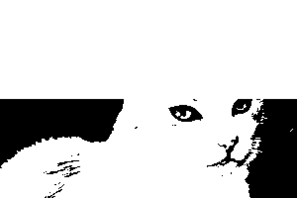
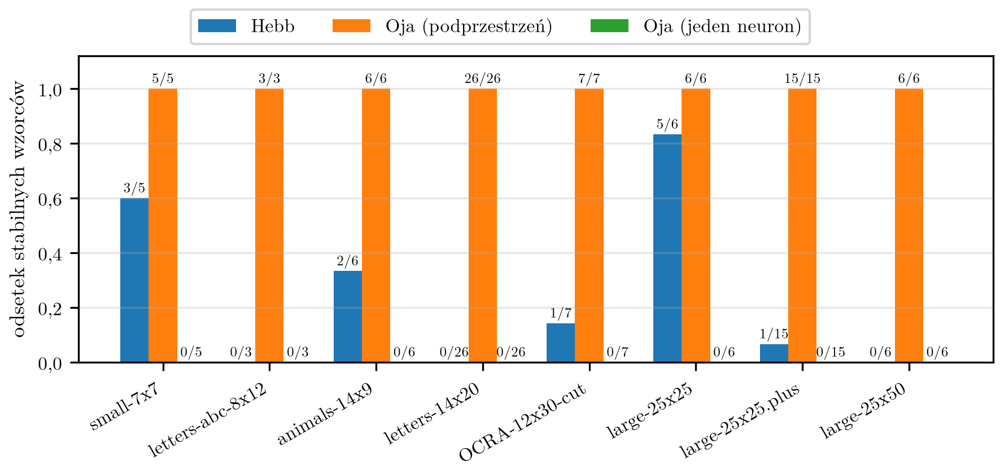
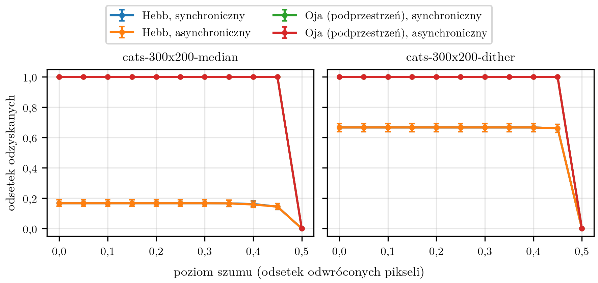
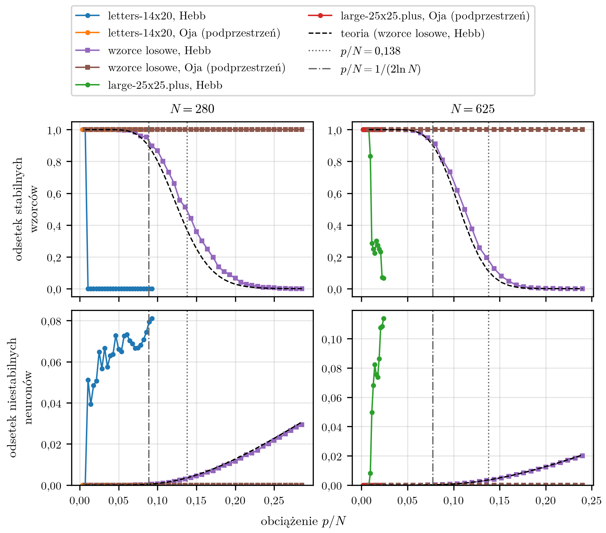
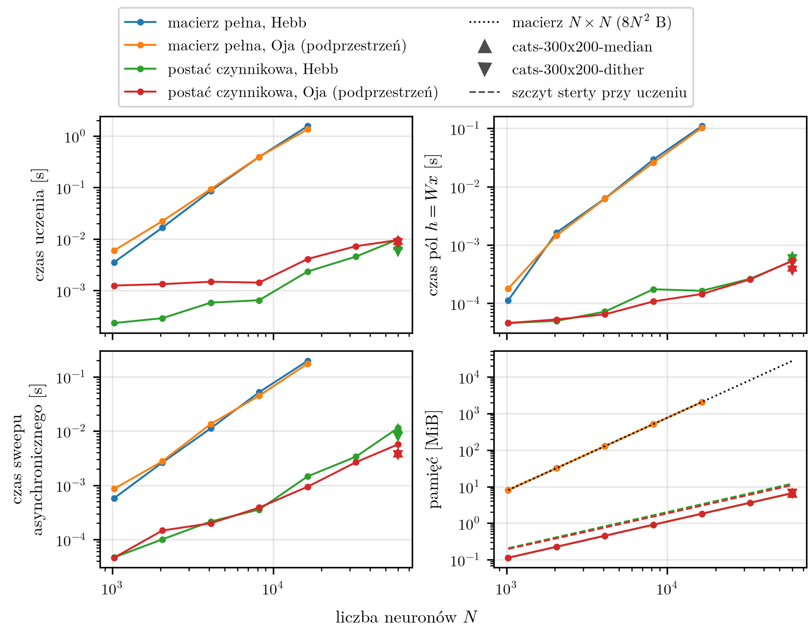
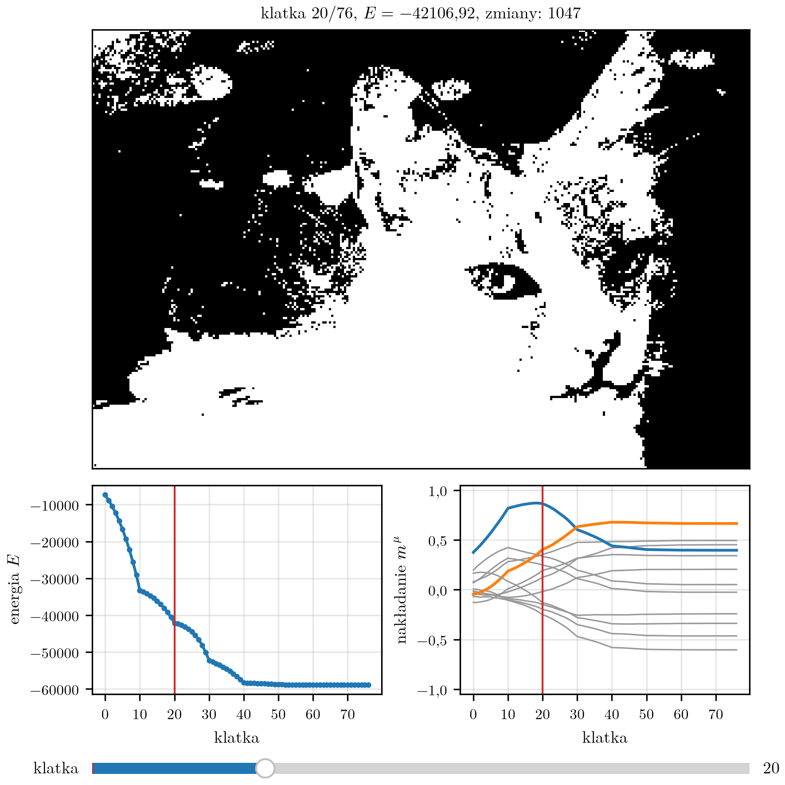
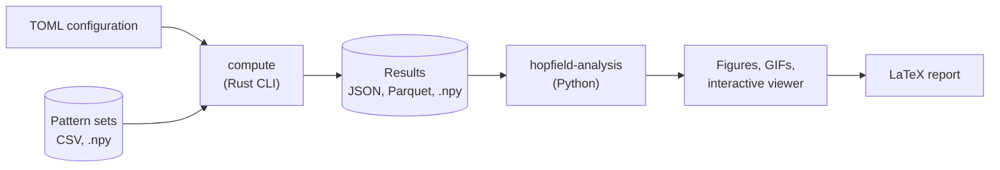

# Hopfield Associative Memory

**A Hopfield network trained with Hebb's rule and Oja's subspace rule, studied on everything from 49-pixel shapes to 60 000-pixel cat photos.**


| Hebb's rule | Oja's subspace rule |
|:---:|:---:|
|  |  |
| ends in a spurious state after 10 sweeps | restores the stored photo after 2 sweeps |

*The same input, a 300x200 cat photo with half of its rows hidden, given to networks of 60 000 neurons that store 12 photos.*

## About

An associative memory stores a set of patterns and recovers any of them from a damaged copy. A Hopfield network does this with a recurrent layer of binary neurons. It updates its state until it reaches a fixed point, which should be the stored pattern closest to the input. Which fixed points exist depends on how the weights are learned. This project implements and compares two learning rules:

- **Hebb's rule** sets each weight from the pattern correlations in one pass.
- **Oja's subspace rule** learns the weights iteratively and converges to the projection onto the span of the patterns (the pseudo-inverse rule), so every linearly independent pattern becomes a fixed point.

The network runs in synchronous and asynchronous mode, scales to any number of neurons and shows every step of the dynamics as a bitmap: as figures, as GIF animations and in an interactive viewer. The experiments answer ten questions about stability, recovery from noise and occlusion, the response to random inputs, constructed stable and oscillating sets, and large images. The full analysis is in the [report](docs/report.pdf), in Polish.

### Key findings

- **Correlations, not the number of patterns, break Hebb's rule.** It keeps only 12 of the 74 patterns of the supplied datasets stable, and only 2 and 8 of 12 cat photos at a load of `p/N = 0.0002`, far below the classical limit of `0.138`. Oja's rule stabilises all of them.
- **Oja's rule recovers every cat photo from inputs with up to 45% of the pixels flipped**, always in a single sweep.
- **A constructed set of 4 992 288 bitmaps of 5x5 pixels is stable under both rules.** It is a hyperplane of `{-1, 1}^25` and reaches 96% of the Erdős bound for such sets.
- **Factored weights make 60 000 neurons practical**: 6.6 MiB instead of 26.8 GiB for a dense matrix, with training in about 10 ms.

## Results

The figures come from the report, so their labels are in Polish.

| Stable stored patterns | Recovery of the cat photos from noise |
|:---:|:---:|
|  |  |
| Hebb (blue) against Oja's subspace rule (orange) and its single-neuron variant (green) on the eight supplied datasets. | Fraction of recovered photos against the fraction of flipped pixels. Oja's rule (red and green) recovers every photo up to 0.45. |
| **Stability against the load `p/N`** | **Time and memory against `N`** |
|  |  |
| Under Hebb's rule random patterns follow the signal-to-noise theory (dashed) and stay stable up to a load of about 0.04, while the correlated letters lose every pattern already at 0.011. | Dense weights grow as `N^2` and stop at 16 384 neurons, factored weights grow linearly up to 60 000. |

The viewer steps through a recall run frame by frame, with the energy and the overlaps with every stored pattern:



## Architecture



The project has two layers. A Rust command-line tool computes everything and writes it to files. A Python package only reads those files and plots them. Every run starts from a TOML configuration with an explicit seed.

- **Factored weights.** Both rules give weights of the form `W = A Xi - diag(d)`, where `Xi` holds the patterns. Storing the `N x p` matrix `A` instead of `W` brings memory and field evaluation down to `O(Np)`.
- **Batched Oja learning.** The subspace rule is trained on `p x p` matrices, so an epoch costs `O(p^3)` whatever the number of neurons.
- **Reproducibility.** Every trial derives its own `ChaCha8Rng` seed, results do not depend on the number of threads, and tests compare the committed results byte for byte with a fresh computation.
- **Exact outcome classes.** A final state is classified as a stored pattern, its negation, a spurious state, a two-cycle or unconverged, with 95% Wilson intervals for every fraction.

## Repository layout

```text
.
├── src/
│   ├── compute/          Rust CLI: learning rules, dynamics, experiments
│   └── analysis/         Python package hopfield-analysis: figures, GIFs, viewer
├── data/
│   ├── datasets/         pattern sets (CSV, .npy) and their registry datasets.toml
│   ├── generated/        configurations of generated datasets (groups of similar patterns)
│   ├── images/           cat photo sources, licenses and conversion settings
│   └── experiments/      one directory per experiment: configuration, results, figures
├── docs/                 LaTeX report and its build scripts
└── scripts/              reproduction of all results
```

See [`src/compute/README.md`](src/compute/README.md) and [`src/analysis/README.md`](src/analysis/README.md) for the commands and configuration format.

## Getting started

Requirements: [rustup](https://rustup.rs/) (the pinned toolchain is installed automatically) and [uv](https://docs.astral.sh/uv/) (installs Python 3.13 and the locked dependencies).

```bash
git clone https://github.com/adamgracikowski/HopfieldAssociativeMemory.git
cd HopfieldAssociativeMemory/src/compute
cargo build --release

# Show a dataset in the terminal
cargo run --release -- inspect small-7x7

# Recall a cat photo with half of its rows hidden
cargo run --release -- recall --config ../../data/experiments/cats-occlusion/recall-occlusion-oja.toml \
    --out ../../data/experiments/cats-occlusion/runs/recall-occlusion-oja --force

# Step through the recall in the viewer (arrow keys, Home/End) and save it as a GIF
cd ../analysis
uv sync
uv run hopfield-analysis view ../../data/experiments/cats-occlusion/runs/recall-occlusion-oja
uv run hopfield-analysis animate ../../data/experiments/cats-occlusion/runs/recall-occlusion-oja --scale 2 \
    --out ../../data/experiments/cats-occlusion/plots/cat.gif
```

## Reproducing the results

One script recomputes every experiment and redraws every figure. It runs the commands listed in the comments of the experiment configurations:

```bash
scripts/reproduce.sh                       # Linux, macOS, Git Bash
pwsh -File scripts/reproduce.ps1           # Windows PowerShell
```

Options: experiment names to run only those (`scripts/reproduce.sh noise cats-noise`), `--figures-only` (`-FiguresOnly`) to redraw the figures (the recall figures need the `runs/` of an earlier full run), and `--benchmark` (`-Benchmark`) to remeasure time and memory on your machine, which is skipped by default. The computations are deterministic, so afterwards `git status` shows only the `metadata.json` files (time and build commit) and the creation dates inside the figure PDFs.

| Experiment | What it studies | Report chapter |
|---|---|---|
| `stability`, `stability-single-neuron`, `capacity` | which stored patterns are fixed points, and why | 5 |
| `large-recovery` | two almost identical datasets at 25x25 and 25x50 pixels | 5 |
| `noise`, `occlusion`, `load`, `groups` | recovery from flipped pixels and covered rows, set size, groups of similar patterns | 6 |
| `random`, `random-load` | where random inputs end and how deep the spurious states are | 7 |
| `stable-5x5`, `cycle` | a large stable set of 5x5 bitmaps and an input that oscillates | 8 |
| `cats-noise`, `cats-occlusion`, `benchmark` | 300x200 cat photos, time and memory up to 60 000 neurons | 9 |
| `example` | a small demonstration grid | |

The report is built with `docs/scripts/build-tex.sh docs/report.tex` (or `build-tex.ps1`), which needs `pdflatex` and `biber`.

## Report

[`docs/report.pdf`](docs/report.pdf) (in Polish, 34 pages):

1. Introduction
2. The Hopfield network: model, dynamics, energy, Hebb's rule, Oja's rule and why they work
3. Implementation
4. Datasets and methodology
5. Stability of the stored patterns
6. Recovery from damaged inputs
7. Response to random inputs
8. Constructed sets: a large stable set and an oscillation
9. Large bitmaps: cat photos, time and memory
10. Summary: answers to the ten questions, conclusions and limitations

Appendices list the photo sources and the reproduction commands.

## License

The code is licensed under the MIT License (see [`LICENSE`](LICENSE)). The cat photos come from Wikimedia Commons under Creative Commons licenses (CC BY and CC BY-SA). The bitmaps in `data/datasets/cats-*.npy` are adaptations that keep the license of their photo. Authors and licenses are listed in [`data/images/cats/sources.tsv`](data/images/cats/sources.tsv) and [`data/images/README.md`](data/images/README.md).
